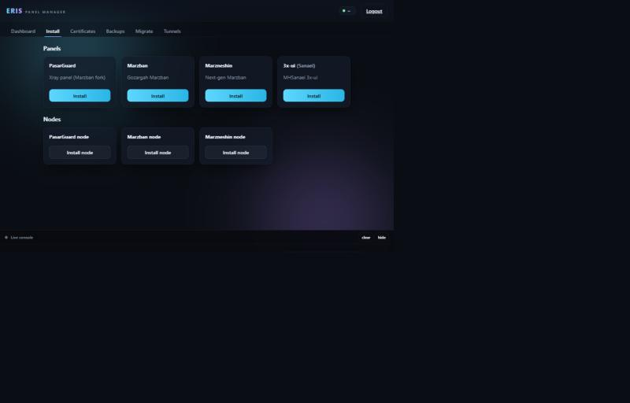
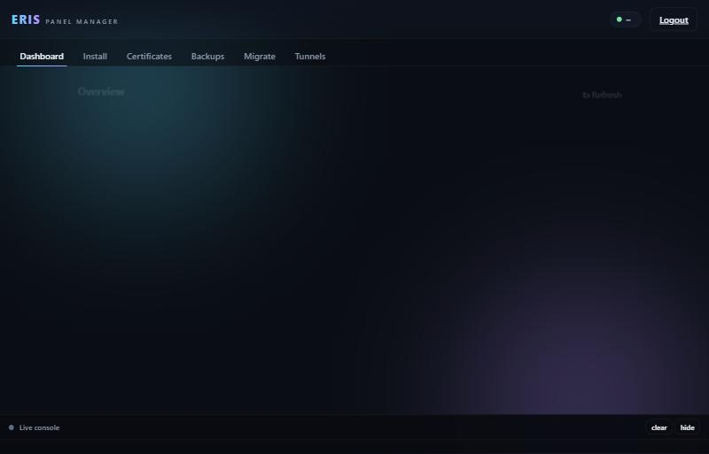
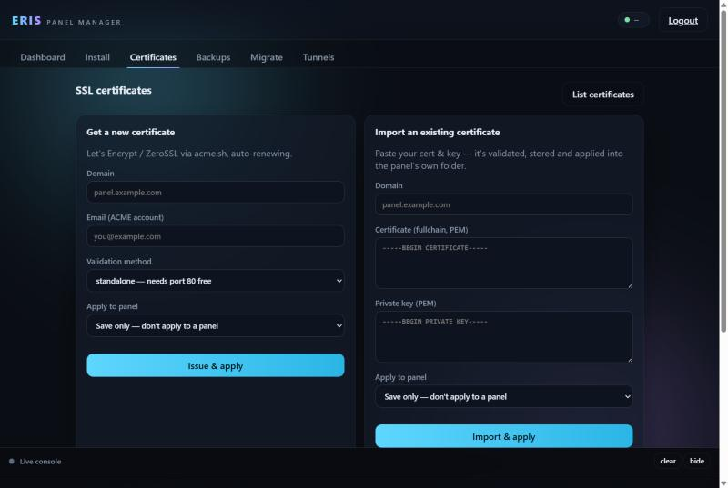

<div align="center">

# ⚡ اریس پنل منیجر

**با یک دستور، همه‌ی پنل‌های پراکسی‌ت رو نصب، امن، بکاپ، مهاجرت و تانل کن.**

PasarGuard · Marzban · Marzneshin · 3x‑ui (سنایی) — به‌همراه نودهاشون، سرتیفیکیت SSL،
بکاپ و بازیابی دیتابیس، مهاجرت سرور‌به‌سرور، و تانل‌های Spoof Tunnel و Eris Tunnel 2 —
همه از یک منوی ترمینالی رنگی **یا** یک پنل وب خوش‌دست.

[🇬🇧 English](README.md)




</div>

---

## چرا؟

مدیریت زیرساخت پراکسی یعنی سر‌و‌کله‌زدن با چند پنل، نودهاشون، سرتیفیکیت‌های لتس‌اینکریپت،
بکاپ شبانه‌ی دیتابیس، و گاهی مهاجرت پراسترس به سرور جدید — که هرکدوم دستور و دردسر خودش رو داره.

**اریس پنل منیجر** همه‌ی این‌ها رو پشت یک دستور `erispm` جمع می‌کنه. منوی ترمینالی و پنل وب
دقیقاً از یک بک‌اند مشترک استفاده می‌کنن؛ پس هرکاری توی یکی بشه، توی اون‌یکی هم هست.

> هیچ پنلی رو از نو پیاده‌سازی نمی‌کنه. **نصاب‌های رسمی بالادست** رو صدا می‌زنه تا همیشه نرم‌افزار
> واقعی و به‌روز نصب بشه — و دور‌و‌برش ارکستراسیون، سرتیفیکیت، بکاپ، مهاجرت و تانل اضافه می‌کنه.

---

## امکانات

| بخش | چی به‌دست میاری |
|---|---|
| **تشخیص** | پنل/نود/تانل‌هایی که **بیرون از erispm** نصب شدن رو هم پیدا می‌کنه و وضعیت **واقعیِ روشن بودن** رو از کانتینرهای زنده‌ی داکر / `x‑ui` می‌خونه |
| **نصب پنل** | PasarGuard · Marzban · Marzneshin · 3x‑ui (سنایی) |
| **نصب نود** | نود PasarGuard · نود Marzban · نود Marzneshin |
| **سرتیفیکیت** | لتس‌اینکریپت/ZeroSSL با `acme.sh` **یا ایمپورت سرت خودت**؛ اعمال خودکار داخل پوشه‌ای که خود پنل و داکرش می‌خونه + کانفیگ + ری‌استارت؛ تمدید و اعمال مجدد خودکار |
| **بکاپ** | تکی یا همگانی؛ چک‌پوینت SQLite + دامپ MySQL/MariaDB؛ با چک‌سام SHA‑256 |
| **بازیابی** | ریستور تأییدشده، آگاه به سرویس (stop/start)، ایمپورت مجدد SQL |
| **حذف** | آن‌اینستال رسمی + پاک‌سازی اختیاری دیتا — همیشه اول یک بکاپ ایمنی می‌گیره |
| **مهاجرت** | مبدأ → سرور جدید، **تکی یا همگانی**، با dry‑run اول |
| **تانل** | Spoof Tunnel — نصب، مدیریت تانل‌ها و تستر اسپوف از یک **رابط اختصاصی Eris** · Eris Tunnel 2 |
| **پنل وب** | لاگین با پسورد، **ترمینال تعاملی داخل مرورگر** (جواب دادن به سؤال‌های نصاب‌ها، باز کردن منوی کامل)، داشبورد وضعیت — فقط Python 3 بدون pip و بدون CDN |
| **منوی ترمینالی** | منوی تمام‌صفحه‌ی رنگی، با هر اسم فایلی کار می‌کنه |

---

## نصب سریع

```bash
curl -fsSL https://raw.githubusercontent.com/eris4444/eris-panel-manager/main/install.sh | bash
```

بعدش فقط اجرا کن:

```bash
erispm
```

روی Debian/Ubuntu، RHEL/Alma/Rocky، Alpine و Arch کار می‌کنه. نیاز به `root` داره.

---

## پنل وب

یک داشبورد بدون‌وابستگی (فقط کتابخانه‌ی استاندارد Python 3 — هیچ‌چی از `pip` و هیچ‌چی از CDN) که همون
بک‌اند `erispm` رو داخل یک **ترمینال واقعی توی مرورگرت** اجرا می‌کنه.

```bash
erispm web install      # انتخاب پورت، تنظیم پسورد، HTTPS سلف‌ساین اختیاری
erispm web start|stop|restart|status|url
erispm web passwd       # تغییر پسورد ادمین
```

<div align="center">

&nbsp;

</div>

- **احراز هویت** — یوزرنیم + پسورد SHA‑256 نمک‌دار، کوکی نشست امضاشده با HMAC و انقضادار، `HttpOnly` + `SameSite=Strict`.
- **امنیت** — هر عملیات از یک allow‑list سخت‌گیر رد می‌شه و به‌صورت آرایه‌ی آرگومان اجرا می‌شه
  (نه رشته‌ی شل)، پس هیچ‌چیزی از مرورگر نمی‌تونه دستور تزریق کنه.
- **ترمینال تعاملی** — هر عملیات روی یک شبه‌ترمینال (PTY) روی سرور اجرا می‌شه؛ پس وقتی نصاب رسمی
  سؤالی می‌پرسه (API key نود، سرتیفیکیت، پورت، «دوباره نصب کنم؟») کافیه روی ترمینال کلیک کنی و جواب بدی.
  رنگ کامل، پیست با Ctrl+V، دکمه‌های سریع برای موبایل (Enter، Ctrl‑C، Ctrl‑D، ↑ ↓، Tab، Esc، y، n) و دکمه‌ی
  **Stop** (اول Ctrl‑C، بعد SIGTERM؛ با زدن دوباره SIGKILL).
- **Open erispm menu** — کل منوی ترمینالی، داخل مرورگر.
- **وصل شدن دوباره** — اگه صفحه رو رفرش کنی یا اینترنت قطع و وصل بشه، کار در حال اجرا با خروجی اخیرش برمی‌گرده.
- **تب Spoof panel** — یک رابط اختصاصی Eris برای اسپوف تانل: تانل‌ها، تستر اسپوف و تنظیمات (پایین‌تر توضیح داده شده).

> پنل وب با `root` اجرا می‌شه (چاره‌ای نیست، باید سرویس‌های سیستم رو مدیریت کنه). پشت HTTPS بذارش،
> پسورد قوی انتخاب کن، و پورتش رو فقط به آدرس‌های مورد‌اعتماد باز کن.

---

## سرتیفیکیت



یا یک سرت جدید از [`acme.sh`](https://github.com/acmesh-official/acme.sh) بگیر (لتس‌اینکریپت/ZeroSSL، تمدید خودکار)
**یا سرت و کلید خودت رو ایمپورت کن** — بعد erispm اون رو جایی می‌ذاره که پنل واقعاً بتونه ازش استفاده کنه.

وقتی سرت رو روی یک پنل **اعمال** می‌کنی، erispm:
1. اون رو در `/var/lib/<panel>/certs/<domain>/` کپی می‌کنه — پوشه‌ای که **با همون مسیر داخل کانتینر داکر پنل
   مونت شده**، پس کانتینر می‌تونه بخونش (3x‑ui که بدون داکر اجرا می‌شه پوشه‌ی خودش رو می‌گیره)؛
2. کانفیگ SSL پنل رو به اون اشاره می‌ده — `UVICORN_SSL_CERTFILE` / `UVICORN_SSL_KEYFILE` در `.env` مرزبان /
   پاسارگارد / مرزنشین، یا `x-ui cert` برای 3x‑ui؛
3. پنل رو ری‌استارت می‌کنه. موقع تمدید هم خودکار دوباره اعمال می‌شه.

اگه فقط می‌خوای ذخیره بشه (`--apply none`، پیش‌فرض)، نسخه‌ی اصلی در `/etc/eris-panel-manager/certs/<domain>/` می‌مونه.

---

## مرجع دستورات (CLI)

هرکاری که منوها می‌کنن، یک ساب‌کامند ساده هم هست — مناسب اتوماسیون و خودِ پنل وب.

```bash
erispm install-panel <pasarguard|marzban|marzneshin|3x-ui>
erispm install-node  <pasarguard-node|marzban-node|marzneshin-node>
erispm delete-panel  <key> [--purge]
erispm backup  <pasarguard|marzban|marzneshin|3x-ui> [outdir]
erispm restore <key> <archive.tar.gz>
erispm cert issue  --domain panel.example.com --email you@example.com --apply all|<key>
erispm cert import --domain panel.example.com --cert-file F --key-file K --apply all|<key>
erispm cert apply  --domain panel.example.com --panel all|<key>
erispm cert sync <domain>        # اعمال مجدد بعد از تمدید
erispm cert list
erispm migrate --to root@NEW_IP --port 22 --panels ALL --dry-run
erispm tunnel install <spoof|eris-tunnel-2>
erispm web <install|start|stop|restart|status|url|passwd>
erispm status [--json]
erispm update
```

فلگ‌های سراسری: `-y` / `--yes`، `NO_COLOR=1`، `ERISPM_YES=1` (کاملاً غیرتعاملی).

وقتی ترمینال وصله، نصاب‌های رسمی می‌تونن سؤال خودشون رو بپرسن؛ بدون ترمینال (cron، پایپ) ورودی‌شون
`/dev/null` می‌شه و `docker logs -f` آخرشون کوتاه می‌شه تا اجرا تموم بشه.

---

## مهاجرت

**روی سرور قدیمی** (مبدأ) اجراش کن. برای هر پنل یک بکاپ می‌گیره، روی SSH به مقصد کپی می‌کنه،
همون پنل رو اونجا نصب و ریستور می‌کنه — تکی یا همه با‌هم.

```bash
# اول یک dry-run کامل (بدون تغییر)
erispm migrate --to root@203.0.113.9 --panels ALL --dry-run

# بعد واقعی (احراز با کلید)
erispm migrate --to root@203.0.113.9 --panels ALL

# احراز با پسورد، یک پنل خاص، پورت دلخواه
ERISPM_SSH_PASS='…' erispm migrate --to root@203.0.113.9 --port 2222 \
  --panels marzban --password-env ERISPM_SSH_PASS
```

بعد از مهاجرت، DNS دامنه رو به سرور جدید اشاره بده و سرتیفیکیت‌ها رو همون‌جا دوباره بگیر
(`erispm` → *Certificates*).

---

## اسپوف تانل داخل پنل

اسپوف تانل با نصاب رسمی خودش ([ParsaKSH/spoof-tunnel](https://github.com/ParsaKSH/spoof-tunnel)) نصب می‌شه و بک‌اند
خودش رو داره (پورت رندوم + مسیر مخفی + یوزر و پسورد خودش). پنل وب erispm براش یک **رابط اختصاصی با طراحی Eris**
توی تب *Spoof panel* می‌سازه: تانل‌ها (ساخت / ویرایش / استارت / استاپ / حذف، با لاگ زنده)، تستر اسپوف
(receiver / sender، با کپی و دانلود IPهای قبول‌شده) و تنظیمات. این رابط با API رسمی بک‌اند از طریق یک
ریورس‌پراکسی هم‌مبدأ حرف می‌زنه (erispm پورت و مسیر رو از `spoof-panel.service` و تنظیمات پنل می‌خونه)؛ پس
هستهٔ تانل و APIش دست‌نخورده و بالادست می‌مونه، روی همون پورت و HTTPS خود erispm در دسترسه و فقط بعد از لاگین
به erispm. یوزر و پسوردی که نصاب اسپوف چاپ کرد رو یک‌بار وارد می‌کنی (فقط توی مرورگرت می‌مونه) — یا اگه نصب تازه‌ست و
هنوز ادمین نداره، همون‌جا ادمین می‌سازی. یک تب **Guide** کل روند رو داخل پنل توضیح می‌ده، یک **ویزارد New tunnel**
هر سرور رو به‌عنوان سمت ایران یا خارج با فیلدهای درست و ترنسپورت‌های آینه تنظیم می‌کنه، و **Spoof Tester** می‌تونه
IPهای قبول‌شده رو مستقیم بریزه توی یک تانل. پنل اصلی هم با یک کلیک («Original panel ↗») باز می‌شه و آدرس مستقیمش کار می‌کنه.

نصاب اسپوف هر بار که اجرا بشه **پورت جدید و یک لاگین تازه** می‌سازه؛ برای همین `erispm tunnel install spoof`
پنلی که از قبل نصبه رو دست نمی‌زنه (برای نصب دوباره: `--force`).

**لاگین پنل اسپوف** رو می‌تونی از تب Settings (یا از CLI) عوض کنی: یوزرنیم و پسورد جدید بذاری، یا یک لاگین دوم
اضافه کنی. API رسمی اسپوف این رو نداره، برای همین erispm این کار رو با دسترسی root روی دیتابیس خود پنل انجام می‌ده و
هش پسورد رو خود باینری `spoof-panel` می‌سازه (تا سازگار بمونه):

```bash
erispm spoof set-login --user newadmin --pass 'new-password'   # جایگزینی لاگین
erispm spoof add-user  --user teammate --pass 'their-password' # افزودن یک لاگین
```

یک **تست سریع قابلیت اسپوف** هم توی منوی Tunnels هست. اگه بهش دسترسی SSH سرور مقابلت رو بدی، خودش روی اون
سرور `tcpdump` می‌گیره، از این طرف یک برست ICMP جعلی می‌فرسته و خودش **PASS/FAIL** می‌گه که پکت‌های جعلی واقعاً
رسیدن یا نه (یعنی می‌فهمی provider اجازهٔ اسپوف می‌ده و کدوم IPها کار می‌کنن). بدون SSH هم حالت دستی
(«خودت `tcpdump` رو ببین») کار می‌کنه.

---

## 💜 حمایت

اگه برات وقت صرفه‌جویی کرد، یه کمک کوچیک پروژه رو زنده نگه می‌داره:

<!-- آدرس‌های زیر placeholder هستن؛ آدرس ولت واقعی‌ت رو جایگزین کن و کامیت کن. -->
| دارایی | آدرس |
|---|---|
| USDT (TRC20) | `YOUR_USDT_TRC20_ADDRESS_HERE` |
| USDT (BEP20)  | `YOUR_USDT_BEP20_ADDRESS_HERE` |
| TON | `YOUR_TON_ADDRESS_HERE` |
| BTC | `YOUR_BTC_ADDRESS_HERE` |

ارتباط / پشتیبانی: **@erisrttg**

---

## تشکر

اریس پنل منیجر یک ارکستریتوره — همه‌ی کار اصلی رو این پروژه‌های عالی بالادست انجام می‌دن که
مستقیم از منبع رسمی‌شون نصب می‌شن:

- [PasarGuard](https://github.com/PasarGuard) · [Marzban](https://github.com/Gozargah/Marzban) ·
  [Marzneshin](https://github.com/marzneshin/Marzneshin) · [3x‑ui](https://github.com/MHSanaei/3x-ui)
- [acme.sh](https://github.com/acmesh-official/acme.sh)
- [spoof-tunnel](https://github.com/ParsaKSH/spoof-tunnel) · [Eris Tunnel 2](https://github.com/eris4444/eris-tunnel-2)

## لایسنس

[MIT](LICENSE) © 2026 eris4444
